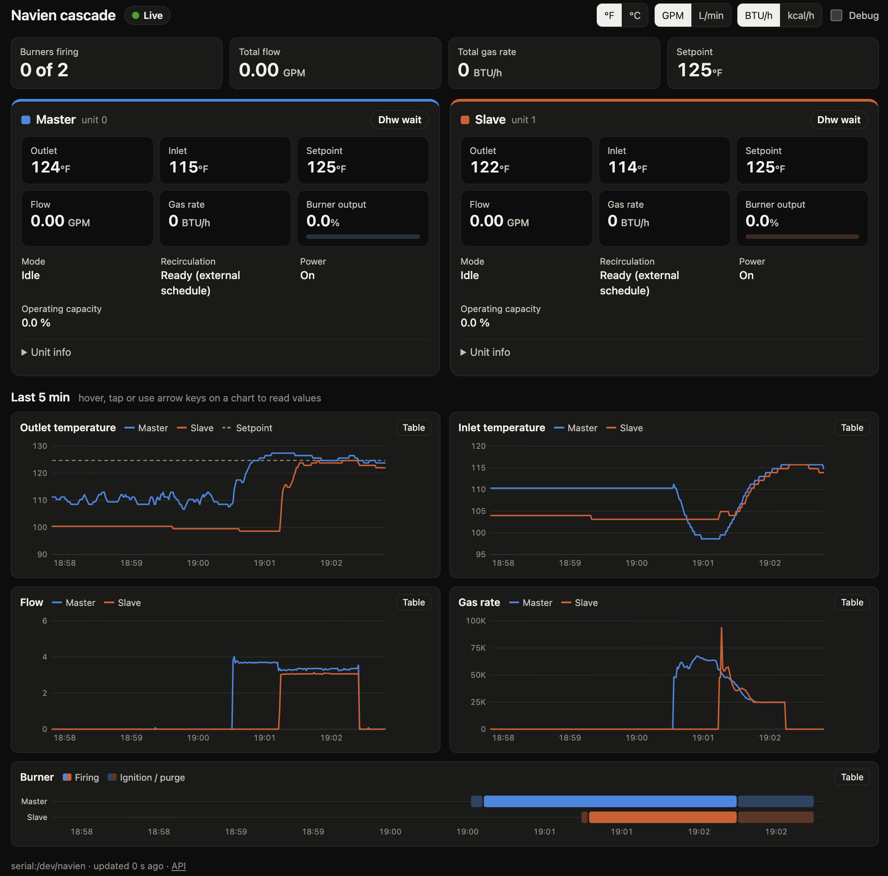

# navien-dash

A passive monitor and live web dashboard for two **Navien NPE-240A2** tankless water
heaters running in cascade. It listens to the heaters' RS-485 bus, decodes every frame
from both units, keeps a rotating raw log, and serves a dashboard and JSON API on the LAN.

**It is receive-only.** Nothing in this project writes to the bus.

The protocol work behind it, including the byte map, the cycle schedule and the open
questions, is in [`PROTOCOL_NOTES.md`](PROTOCOL_NOTES.md). The service's architecture and
phased plan are in [`PLAN.md`](PLAN.md).



## Features

- **Household view:** for each unit, its state, setpoint, outlet and inlet temperatures,
  flow, firing rate and gas use, plus live charts of the last few minutes. Units toggle
  between °F/°C, GPM/L/min and BTU/h/kcal/h, and the choice is saved in the browser.
- **Debug view:** raw hex for every stream with changed bytes highlighted, a field overlay
  from the decoder, per-byte detail and plots, and a frame log. Built for reverse-engineering
  the bytes that are still unknown.
- **JSON API and WebSocket push** for other clients. OpenAPI docs are at `/docs`.
- **Raw log, always on** for the live bus: hourly UTC files with frame timestamps, gzipped
  when closed, with retention limits. Any of them can be re-parsed or replayed.
- **Replay mode:** feed a raw log or capture through the whole stack instead of the serial
  port, at real time or faster.
- **Debian package** with a hardened systemd service and a udev rule.
- **InfluxDB 1.x export:** per-second samples of both units and the cascade, plus counters
  and bus health, batched and buffered through outages. Setup in
  [`grafana/README.md`](grafana/README.md).
- **Events and hourly totals:** hot-water draws (volume, gas, peak flow, time to hot, whether
  the second unit was called in), recirculation runs, burner cycles (ignitions, short and
  failed starts), staging and errors, plus hourly litres, kcal and counts split by purpose.
- **Backfill:** `navien-dash backfill` loads the raw logs into Influx with the same event
  detection, so history starts with the first raw log, not the day Influx was enabled.
- **Grafana dashboards:** overview, hot water, gas and cost, recirculation, cascade and
  equipment, and per-second detail, in US units with a gas-price variable
  ([`grafana/README.md`](grafana/README.md) §7).

## Hardware

- Two NPE-240A2 heaters cascaded over a 2-wire A/B cable between their RS-485 ports.
- A USB RS-485 adapter teed onto that cable. This project uses a Waveshare
  "USB TO RS485 (C)" (FT232RNL, isolated). Wire A+→A, B−→B and GND→heater GND. **Never
  connect the port's ~13 V pin.**
- A Raspberry Pi 4 running Ubuntu 26.04 (arm64) with Python 3.14.

The bus runs at 19200 baud 8N1 with a fixed 1-second cycle of seven frames. The master is
`0x50` and the slave `0x51`. On these units sys_type is `0x02`, which differs from the
`0x05` that single units report in the community decodes. Details are in `PROTOCOL_NOTES.md`.

## Install (Debian package)

Build on the Pi from a clean, tagged tree:

```sh
scripts/build-deb.sh            # -> dist/navien-dash_<version>_arm64.deb
sudo apt install ./dist/navien-dash_<version>_arm64.deb
```

The package installs and enables the `navien-dash` service, which serves
`http://<pi>:8000`. It also adds a udev rule that creates `/dev/navien` for FT232R
adapters and sets the FTDI latency timer to 1 ms.

| What | Where |
|---|---|
| Code and bundled virtualenv | `/opt/navien-dash` |
| Config (conffile, kept on upgrade) | `/etc/navien-dash/navien.toml` |
| Raw logs | `/var/lib/navien-dash/raw` (kept on purge) |
| Logs | `journalctl -u navien-dash` |
| CLI | `navien-dash` (same flags as `python -m navien`) |

After editing the config, run `sudo systemctl restart navien-dash`. The bundled venv is
tied to the system Python minor version, so a Python upgrade needs a rebuild.

## Development

```sh
python3 -m venv venv
venv/bin/pip install -r requirements-dev.txt
cp navien.example.toml navien.toml       # optional; every key has a default
venv/bin/python -m pytest
```

Run against a recorded log (no hardware needed):

```sh
venv/bin/python -m navien --replay /var/lib/navien-dash/raw/<file>.raw.gz --loop --http-port 8765
```

Run against the live bus. Only one process can own the serial port, so stop the packaged
service first:

```sh
sudo systemctl stop navien-dash
venv/bin/python -m navien                # or --headless to print one line per cycle
sudo systemctl start navien-dash
```

| Flag | Meaning |
|---|---|
| `--config FILE` | TOML config (default `./navien.toml` if present) |
| `--port DEV` | serial port, overrides `serial.port` |
| `--http-port N` | HTTP port, overrides `http.port` |
| `--replay FILE` | replay a `.raw`/`.raw.gz` log instead of the serial port (no raw logging) |
| `--speed N` | replay speed, `0` = as fast as possible |
| `--loop` | loop the replay |
| `--headless` | no web server; print cycles |
| `-v` | verbose logging |

`python -m navien backfill [--from WHEN] [--to WHEN] [--dry-run] [PATH…]` (installed:
`navien-dash backfill`) loads raw logs into InfluxDB; see
[`grafana/README.md`](grafana/README.md) §6.

The frontend is plain ES modules in `navien/web/`, with no build step and no CDN. The
charts are hand-written SVG in `charts.js`.

## API

| Route | Purpose |
|---|---|
| `GET /` | dashboard |
| `GET /api` | JSON index of routes |
| `GET /api/state` | latest cycle snapshot |
| `GET /api/history?seconds=300` | in-memory history |
| `GET /api/frames?limit=100&stream=50>51/10` | recent raw frames |
| `GET /api/fields` | the decoder's field table |
| `GET /api/health` | bus status, counters, clients, raw log file, Influx writer |
| `WS /ws` | push channel: `hello`, `history`, then a `cycle` every second; `frame` messages on `{"subscribe":["frames"]}` |
| `GET /docs` | OpenAPI docs |

The server always speaks metric (°C, L/min, kcal/h). The WebSocket protocol is documented
in the `navien/ws.py` docstring.

## Repository layout

```
navien/            the service: protocol, decode, state, source, rawlog, hub, service, api, ws,
                   influx, events, backfill
navien/web/        dashboard (HTML, CSS, ES modules)
tests/             pytest suite (capture-based tests need the local captures/;
                   tests/data/ holds a 15-minute raw log excerpt)
packaging/         systemd unit, udev rule, sysusers, default config, maintainer scripts
scripts/           build-deb.sh, release.sh (GitHub release with the .deb)
navien-capture.py  standalone receive-only sniffer (proof of concept)
PROTOCOL_NOTES.md  protocol findings and open questions
PLAN.md            architecture, phased plan, changelog
docs/              README images
grafana/           InfluxDB/Grafana setup, example queries, six dashboards (build.py -> dashboards/)
```

## Status

| Phase | Version | |
|---|---|---|
| 0: receive and parse | | done |
| 1: service core, REST, packaging | v0.1.x | done |
| 2: WebSocket push | v0.2.0 | done |
| 3a: text dashboard and debug view | v0.3.0 | done |
| 3b: charts | v0.4.0 | done |
| 4a: InfluxDB 1.x writer | v0.5.0 | done |
| 4b: event detection, hourly totals, backfill from raw logs | v0.6.0 | done |
| 4c: Grafana dashboards | v0.7.x | done (accepted 2026-10-29) |

Several bytes are still undecoded, notably the master→slave `0x41` frame's `[26..28]` and
the gas-frame counters. See `PROTOCOL_NOTES.md` §6. Community decodes for single-unit
Navien heaters are treated as hypotheses until verified on this cascade.

## Acknowledgements

This builds on community reverse-engineering of the Navien RS-485 protocol, especially
[htumanyan/navien](https://github.com/htumanyan/navien).

## License

[MIT](LICENSE)
